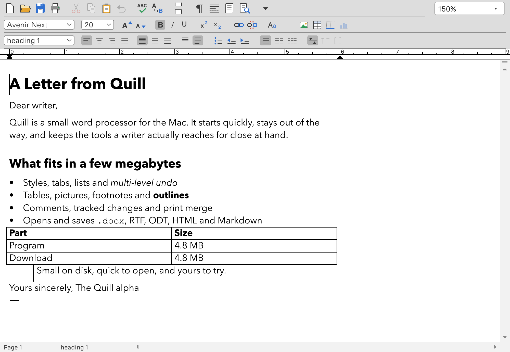
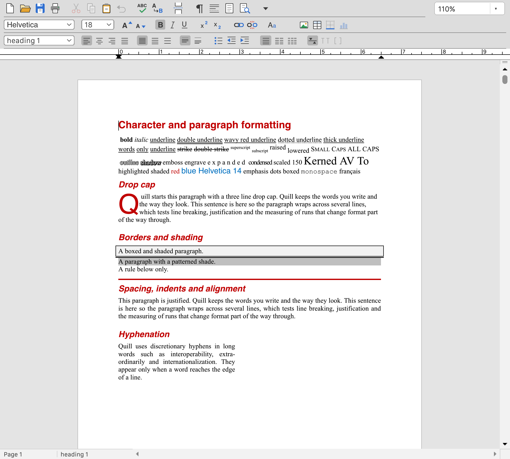

<p align="center">
  
</p>

<h1 align="center">Quill Word Processor</h1>

<p align="center">
  A capable word processor for the Mac in a small package.<br>
  Styles, pictures, tables, long-document tools and modern file formats.
</p>

<p align="center"><a href="https://quillwp.com">quillwp.com</a></p>

**Status: alpha · version 0.14.0.** Alpha testers wanted.



## Small on purpose

Everything in the app, measured from release builds on macOS and Windows:

| Part | macOS (Apple Silicon) | Windows 11 (x86_64) |
|---|---:|---:|
| The program itself | 4.8 MB | 5.34 MB |
| Thesaurus data | 1.4 MB | 1.4 MB |
| Icons and About artwork | 0.9 MB | 0.7 MB |
| Licenses, notices and readme | 0.2 MB | 0.2 MB |
| **Whole app on disk** | **7.3 MB** | **7.6 MB** |
| **Download (compressed)** | **4.8 MB** | **4.83 MB** |

Quill is written from scratch in Rust, draws its own pages and uses native Mac
menus and dialogs. It uses the fonts already installed on your Mac.

## What it does

- **Styles that travel.** Named paragraph and character styles, kept in Quill's
  own format and exchanged with DOCX and RTF.
- **A two-way table of contents.** Headings update the contents. Edit an entry
  and Quill can apply the new name to its heading.
- **Pictures and page layout.** Resize, crop and position pictures, with frames,
  borders, shading, sections, columns, headers and footers.
- **Long documents.** Footnotes and endnotes, outline view, tables of contents,
  indexes, hyperlinks and page numbering.
- **Tables.** Nested tables, merged and split cells, pasting into selected cells
  and cell borders you can drag.
- **Review.** Comments with replies and resolution, and tracked changes with
  accept and reject in one Review pane.
- **Writing tools.** Live spelling, custom dictionaries, thesaurus, hyphenation,
  Find and Replace, word count, sorting and print merge.
- **Markdown, two ways.** Open and save Markdown, and switch between editable
  source and a formatted view.
- **Fonts without installing them.** Load fonts from folders you choose without
  adding them to the system Fonts folder.
- **Your choice of format.** Open and save `.qwp`, DOCX, RTF, ODT, HTML,
  Markdown and plain text, and export PDF. Quill warns when a format cannot
  keep everything.



## Built to protect your work

Quill has multi-level undo, document recovery, atomic saving and read-back
validation: before it replaces a file, it checks that it can open what it just
wrote. Import reports and format warnings explain anything that could not be
kept.

Quill is still alpha software. Keep backups of important documents. The native
`.qwp` format may change during the alpha.

## Why Quill exists

In 1992 a capable Mac word processor fit in under a megabyte and still had
styles, tables, footnotes, pictures and outlines. Quill explores what that idea
looks like on a modern computer: focused word processing, modern document
formats and useful writing tools, in an app measured in megabytes.

## Help test the alpha

Quill is a good fit if you use a Mac with a recent macOS, write real documents
(letters, reports, manuscripts, notes), have DOCX, RTF or OpenDocument files to
try, and are willing to report what breaks. Please
[open an issue](../../issues) for anything that breaks, changes or looks wrong.

Not yet: Windows and Linux builds have had little testing, and screen readers
cannot read the document area yet.

## Building

You need a Rust toolchain with edition 2024 support and Python 3.11 or newer.
On Debian or Ubuntu, also install `libgtk-3-dev` and `libxkbcommon-dev`.

```sh
python3 tools/package.py            # target/release/Quill.app on the Mac
python3 tools/package.py --debug    # debug build
python3 tools/package.py --check    # fmt, clippy and the full test suite first
cargo test --workspace
```

See the [user guide](docs/user-guide.md) and the
[release instructions](docs/release.md) for more.

## Windows and Linux

Quill builds and runs on Windows 11 and Ubuntu 24.04 (amd64), but both have had
much less testing than the Mac build.

## License

Available under either the [MIT license](LICENSE-MIT) or the
[Apache License 2.0](LICENSE-APACHE), at your option. Packaged builds include
[third-party notices](THIRD-PARTY-NOTICES.txt).
