<p align="center">
  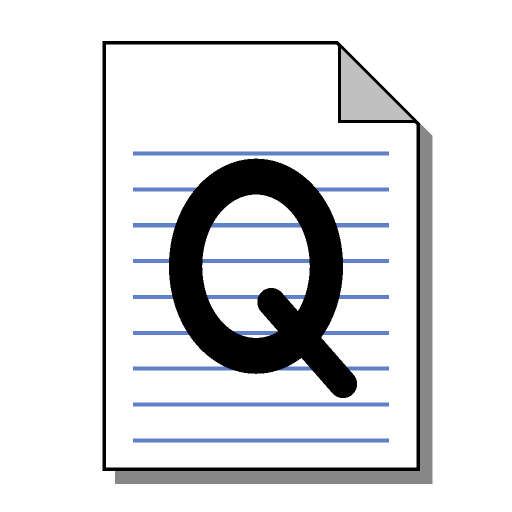
</p>

<h1 align="center">Quill</h1>

<p align="center">
  <strong>Word compatibility in a much smaller package.</strong><br>
  A capable word processor for the Mac that opens and saves DOCX. The Apple
  Silicon version is less than 10 MB.<br>
  Styles, pictures, tables, long-document tools and modern file formats.
</p>

<p align="center"><a href="https://quillwp.com">quillwp.com</a></p>

**Status: beta · version 0.31.0.** Beta testers wanted.
**[Download a build](https://github.com/QuillWP/quill/releases)** from the releases page.

**Word compatibility is a work in progress.** Quill opens and saves DOCX, and
the goal is for documents to go to Word and back with nothing lost. It is not
100% there yet: some documents will look different in Word than in Quill, and
a few features do not survive the round trip. Quill warns when a format cannot
keep everything. Keep a copy of anything important, and please report files
that come out wrong.

## Screenshots

Illustrated page in macOS Light and Dark Mode

<p align="center">
  <a href="assets/screenshots/quill-light-mode.png">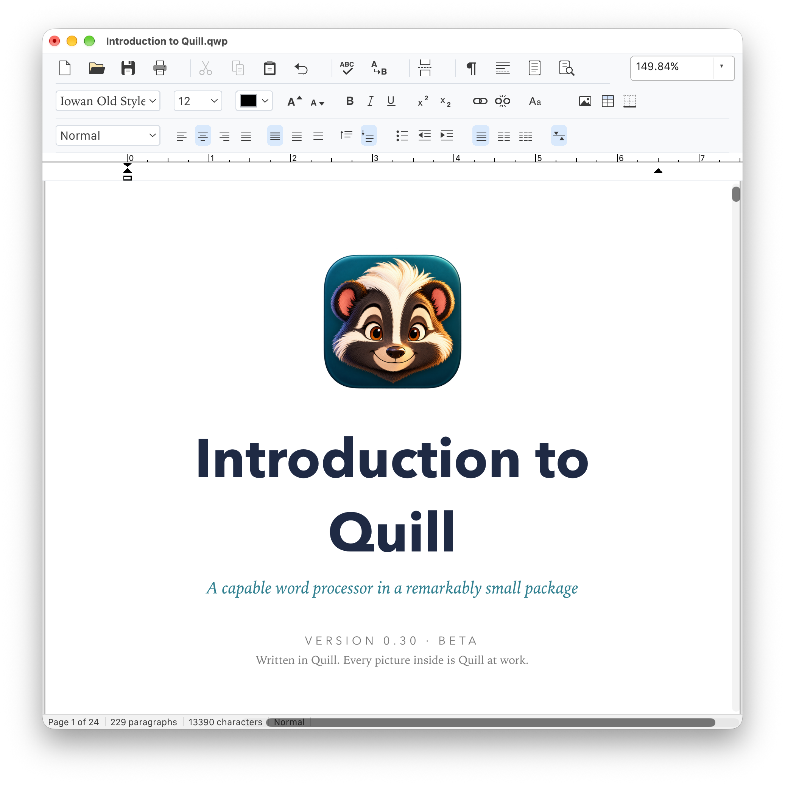</a>
  <a href="assets/screenshots/quill-dark-mode.png">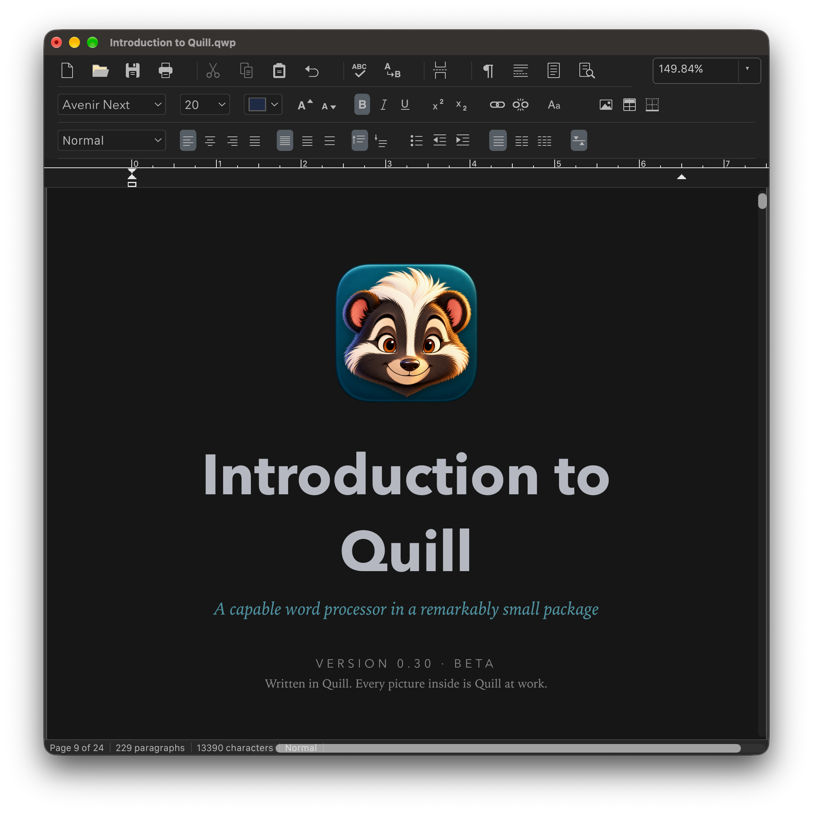</a>
</p>

Table formatting and index references

<p align="center">
  <a href="assets/screenshots/quill-tables.png">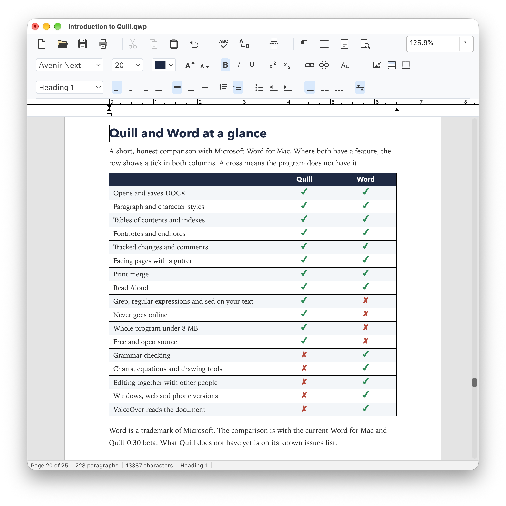</a>
  <a href="assets/screenshots/quill-index.png">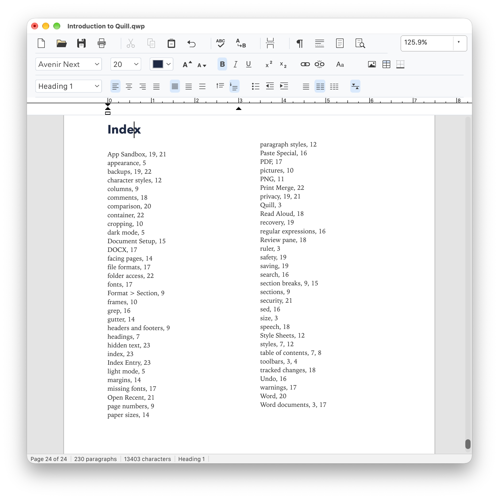</a>
</p>

## New in 0.31.0

- Redesigned Preferences window and Stylesheets palette.
- Full support for macOS emoji, including flags, families, skin tones and
  keycaps.
- Refined paragraph styling options.
- Automatic kerning for fonts that support it.
- Experimental support for ligatures and VoiceOver.
- Increased security against hostile files.

The full list is in [VERSION-HISTORY.md](VERSION-HISTORY.md).

## What it does

- **Styles that travel.** Named paragraph and character styles, kept in Quill's
  own format and exchanged with DOCX and RTF.
- **A two-way table of contents.** Headings update the contents. Edit an entry
  and Quill can apply the new name to its heading.
- **Pictures and page layout.** Resize, crop and position pictures, with frames,
  borders, shading, sections, columns, headers and footers.
- **Long documents.** Footnotes and endnotes, outline view, tables of contents,
  indexes, hyperlinks and page numbering.
- **Tables.** Nested tables, merged and split cells, pasting into selected cells
  and cell borders you can drag.
- **Review.** Comments with replies and resolution, and tracked changes with
  accept and reject in one Review pane.
- **Writing tools.** Live spelling, custom dictionaries, thesaurus, hyphenation,
  Find and Replace, word count, sorting and print merge.
- **Markdown.** Open Markdown files. Saving as Markdown and the Source and
  WYSIWYG views are on hold for now, so no menu offers them; a Markdown file you
  open still saves as itself.
- **Fonts without installing them.** Load fonts from folders you choose without
  adding them to the system Fonts folder.
- **Your choice of format.** Open `.qwp`, DOCX, RTF, ODT, HTML, Markdown and
  plain text; save as `.qwp`, DOCX, RTF, ODT, HTML or text; and export PDF. Quill warns when a format cannot
  keep everything.
- **Indexes and contents that Word can update.** Index and table of contents
  entries save in DOCX as Word's own fields, so a document keeps working in
  Word and comes back with its entries.

## See Quill at work

**Normal view and tables**

| | |
|---|---|
| 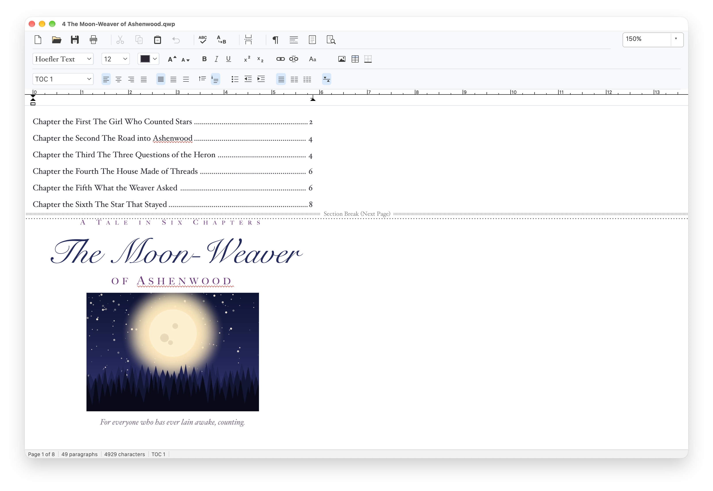 | 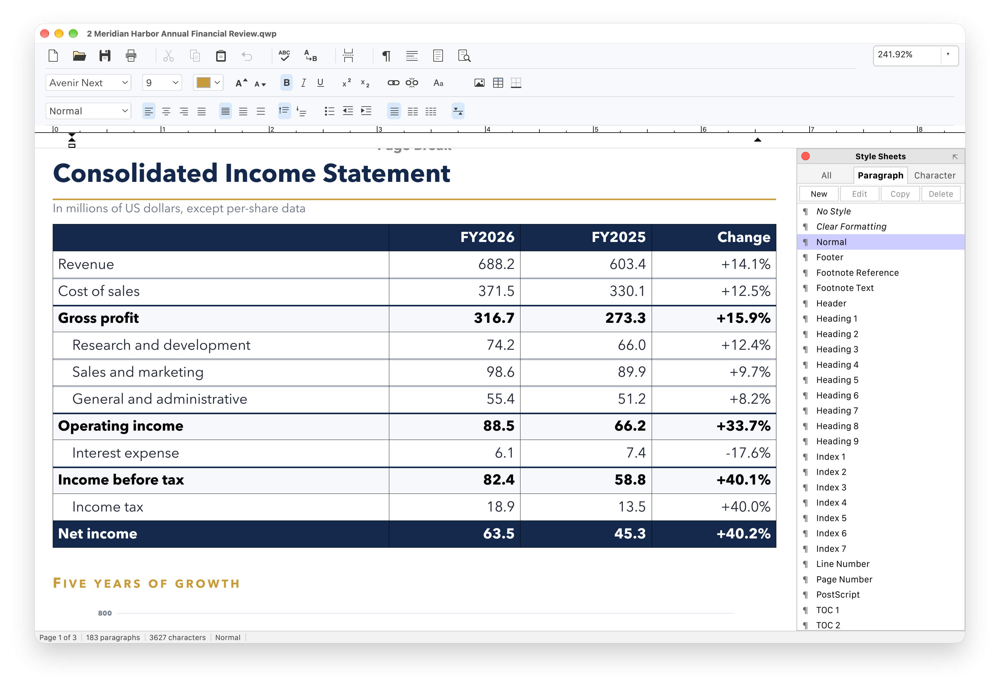 |
| *Normal view: a table of contents with dot leaders and page numbers, a section break, and a title page with a picture and caption.* | *A financial table with a shaded header and total row, indented line items, right-aligned figures and heavier rules between groups. A chart follows below it.* |

**Light and dark**

| | |
|---|---|
| 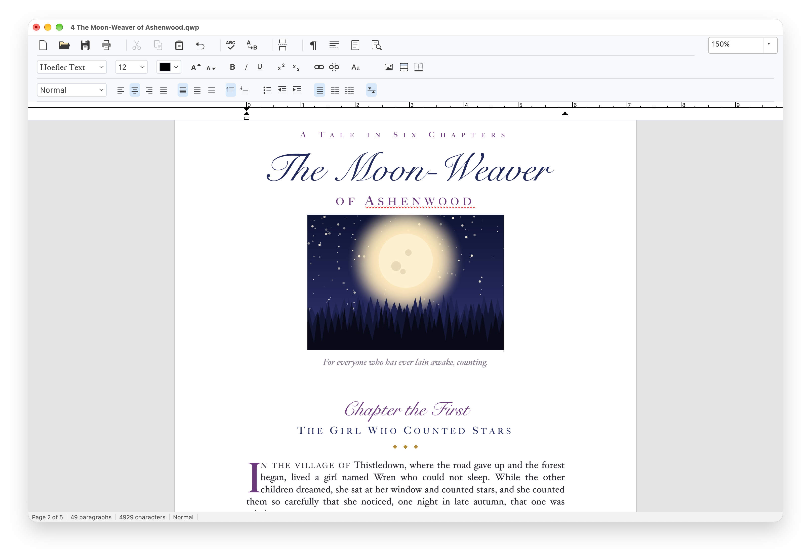 | 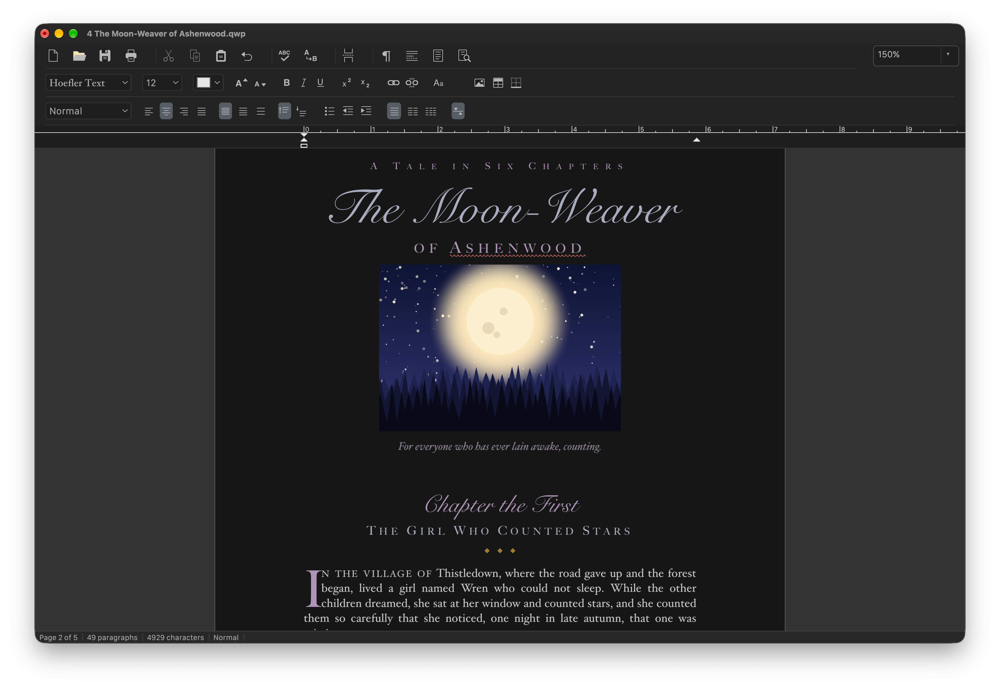 |
| *Light mode: a centered title, a captioned picture, a chapter heading and a drop cap in Page Layout view.* | *The same document in dark mode. The toolbars, ruler and page follow the system appearance, and the document's colors are adjusted to stay readable.* |

**Long documents and styles**

| | |
|---|---|
| 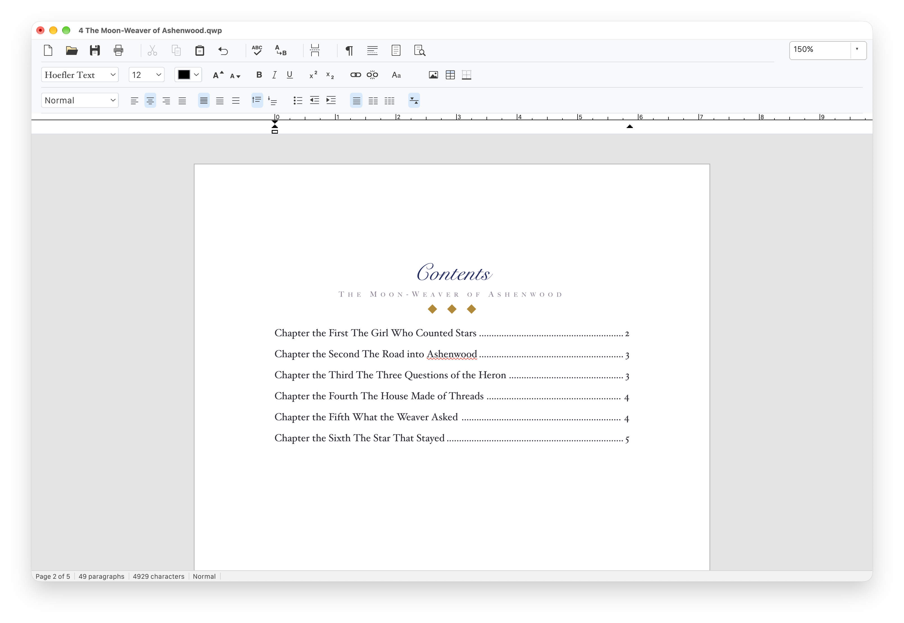 | 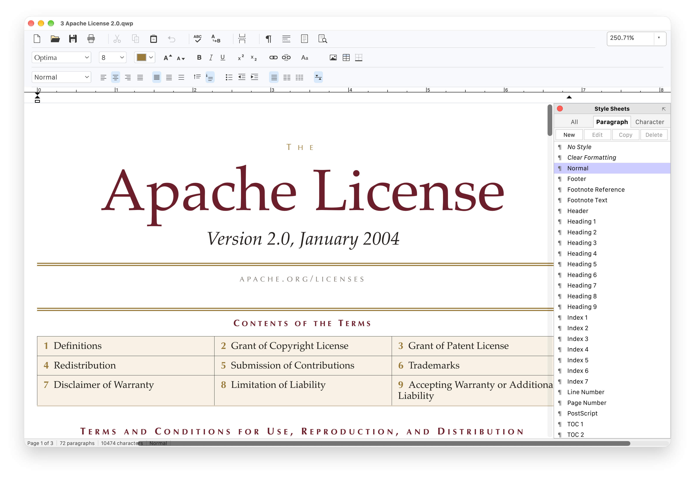 |
| *A table of contents built from chapter headings, with dot leaders and page numbers that update with the document.* | *The Style Sheets pane lists every paragraph and character style. Create, edit, copy or delete styles, and apply one to the current paragraph with a click.* |

## Built to protect your work

Quill has multi-level undo, document recovery, atomic saving and read-back
validation: before it replaces a file, it checks that it can open what it just
wrote. Recovery copies are written in the background, and Quill warns you if
one cannot be saved. With Always Make Backup on, each save keeps the version it
replaces beside the document, as `Report.qwp-backup` (or `Report.docx-backup`).
Import reports and format warnings explain anything that could not be kept.
Links open only for web and mail addresses.

On the Mac, the regular build runs in the App Sandbox, Apple's way of limiting
an app to what you give it. It opens and saves only the documents you choose,
never uses the network, and remembers what you opened so Open Recent works
after a restart. (The debug build, and an app you build from source with
`tools/package.py`, do not run in the sandbox; see Building.) When a Markdown file's pictures or a Print
Merge data document sit in a folder you did not choose, it asks you once to
allow that folder.

Quill is beta software. Keep backups of important documents. The native
`.qwp` format may still change during the beta.

## Why Quill exists

In 1992 a capable Mac word processor fit in under a megabyte and still had
styles, tables, footnotes, pictures and outlines. Quill explores what that idea
looks like on a modern computer: focused word processing, modern document
formats and useful writing tools, in an app measured in megabytes.

## Help test the beta

Quill is a good fit if you use a Mac with a recent macOS, write real documents
(letters, reports, manuscripts, notes), have DOCX, RTF or OpenDocument files to
try, and are willing to report what breaks. Please
[open an issue](https://github.com/QuillWP/quill/issues) for anything that breaks, changes or looks wrong.

Screen reader support is new: VoiceOver can read the main document text, but
it is experimental. See
[KNOWN-ISSUES.md](KNOWN-ISSUES.md) for what is missing or different, and
[CONTRIBUTING.md](CONTRIBUTING.md) for how to report a problem.

### Reporting a freeze

If Quill freezes or misbehaves, start it from a terminal with
`quill --with-events` (a debug build is best). It writes `quill-events.log`,
and says where when it starts: for the downloaded app that is
`~/Library/Containers/com.quillwp.Quill/Data/`, and for a build from source the
folder you started it from. The log has every action, dialog and slow step,
with a "STUCK" line when Quill sits busy and silent. Send the end of that file with
your report. `quill --help` lists the other options, and
[CONTRIBUTING.md](CONTRIBUTING.md) has the details.

### About the AI agent files

`AGENTS.md` and `CLAUDE.md` are in the repository because AI coding agents are
used to work on Quill. They hold the rules those agents follow (build commands,
limits, how dialogs behave). Everything is reviewed and tested by the
maintainer before release.

### Installing a beta build

Quill needs macOS 11 Big Sur or later. Downloads are built for Apple Silicon
Macs (M1 or newer) and for Intel Macs. The Intel builds are made on an Apple
Silicon Mac and have not been tested on Intel hardware yet, so treat them as
experimental and please report problems.

1. Download the newest disk image from the
   [releases page](https://github.com/QuillWP/quill/releases), open it and drag
   Quill to Applications.
2. Beta builds are not signed by Apple yet; version 1.0 will be. The first time
   you open Quill, macOS says it cannot check it for malicious software. Click
   Done (or Cancel), open System Settings > Privacy & Security, scroll down to
   the message about Quill and click Open Anyway, then confirm. You do this once
   for each new version. On macOS 14 or earlier you can instead Control-click
   Quill in Applications and choose Open.

The first version that runs in the App Sandbox starts with fresh settings:
earlier versions kept them in another place, and beta builds do not carry
settings over.

If you would rather build Quill yourself, follow the
[build instructions for the Mac](BUILD_INSTRUCTIONS_MAC.md). An app built from
source runs without the App Sandbox, so it can open any file you can; the
downloadable release is the sandboxed one.

## Building

Step-by-step instructions, including installing the tools, are in
[BUILD_INSTRUCTIONS_MAC.md](BUILD_INSTRUCTIONS_MAC.md). In short, you need the
Xcode Command Line Tools, Rust and Python 3.11 or newer.

```sh
python3 tools/package.py            # target/release/Quill.app on the Mac
python3 tools/package.py --debug    # debug build (Linux: target/debug/quill-debug)
python3 tools/package.py --check    # fmt, clippy and the full test suite first
python3 tools/package.py --sandbox  # a separate App Sandbox test app beside it
python3 tools/package.py --dist     # the packages: release in the sandbox, debug without
cargo test --workspace
python3 tools/overnight.py --until 06:00   # the overnight tests (see the user guide)
```

See the [user guide](docs/user-guide.md) and the
[release instructions](docs/release.md) for more.

## License

Available under either the [MIT license](LICENSE-MIT) or the
[Apache License 2.0](LICENSE-APACHE), at your option. Packaged builds include
[third-party notices](THIRD-PARTY-NOTICES.txt).
